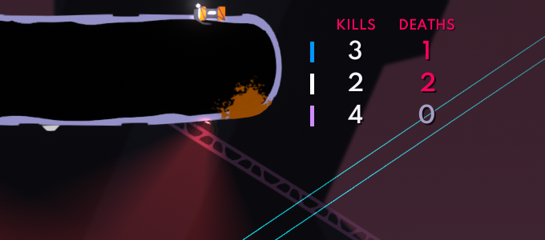
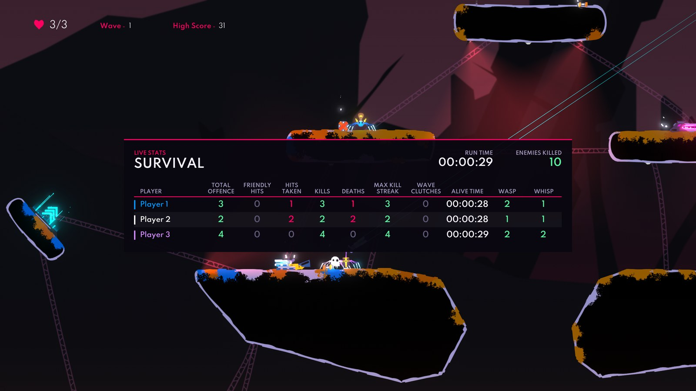
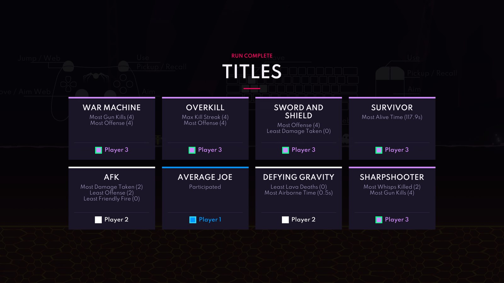
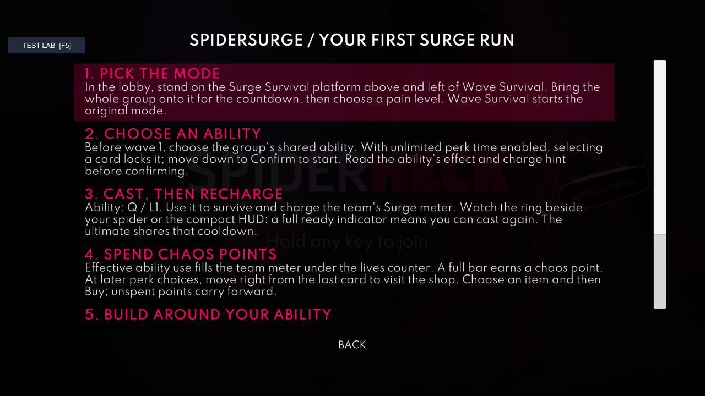
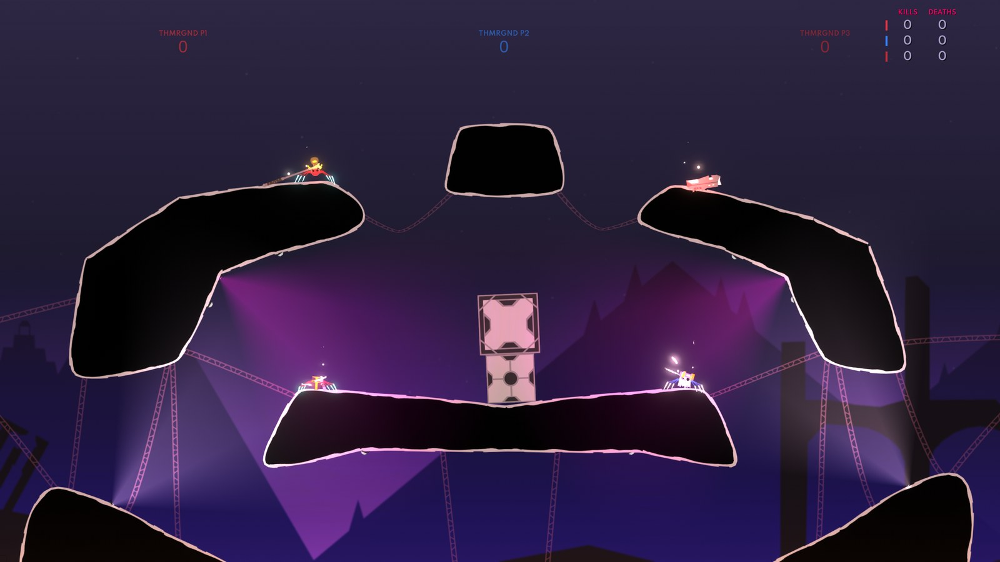
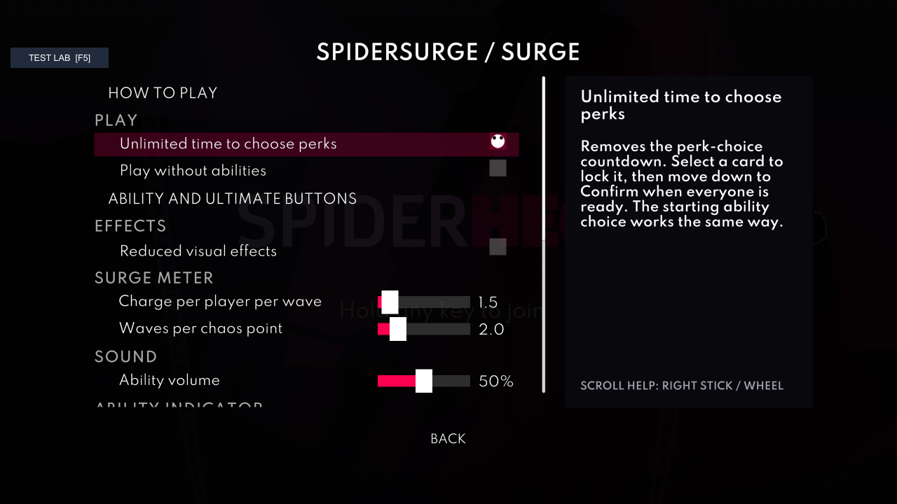
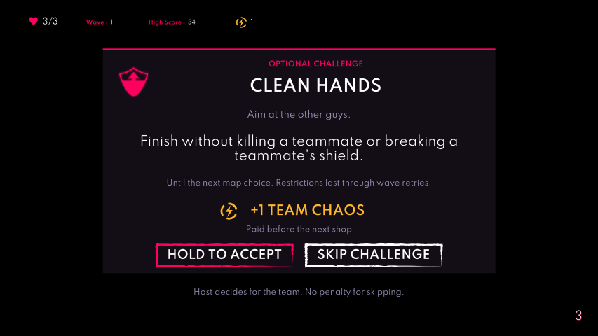

> **Not released yet.** This page describes what `main` holds now, which is not in a release yet. The [README](README.md) describes the latest release. When the next version is released, this file replaces `README.md`.

# SpiderSurge

**Abilities, live stats and team versus for SpiderHeck, all in one mod.**

SpiderSurge is made of four parts. Surge, Stats and Teams always load; Game fixes can be turned on or off from the game's Mods menu.

| Part | What it does | On after installing |
|---|---|---|
| [Stats](stats/README.md) | Tracks kills, deaths, streaks and more in Survival and Versus, with live stats windows and fun titles after Survival runs | Yes |
| [Surge](surge/README.md) | A separate Surge Survival platform above and left of Wave Survival: new abilities, ultimates, perks and custom enemies | Yes |
| [Teams](teams/README.md) | Team versus: pick teams in the lobby, friendly fire rules, team colors and spawns, and Surge abilities in versus | Yes, with team versus off until you turn it on from the versus setup page |
| [Game fixes](#game-fixes) | Fixes bugs in the base game | Yes |

Stats and Teams used to be separate mods, SpiderStats and SpiderTeams. They are now only released as parts of SpiderSurge.

## A look around

Surge has 11 new ability achievements, bringing the collection to 24. They reward interactions with Freeze Time, Rewind, Kinetic Pulse, Pocket Dimension, Black Hole, Thermal Detonation and Neural Backup, including frozen-enemy hazards, reflected missiles and Cocoon hatchlings. See the [achievement list](surge/README.md#achievements) for the unlock conditions.

### Stats

A small live window sits in a corner of the screen while you play: each spider's kills and deaths, next to its color. It fades a spider's row while it's dead. Drag it anywhere with the mouse.

The big window is a full scoreboard: run time, enemies killed and a table with the columns you pick (totals, streaks, wave clutches, alive time, kills per enemy and per weapon, and more). Choose its opening preset in Settings > Stats > Starting scoreboard. My scoreboard has customizable columns; Combat, Enemy kills, Weapon kills, Accuracy and Movement offer fixed sets. Each page fits its columns to the available width. Green is good, pink is a hit you took, amber is friendly fire.

When a run with two or more players ends, everyone gets fun titles based on how they played. The cards are revealed one by one in the lobby.

Achievements and the title collection have All, Locked, Unlocked and Recently earned views. NEW marks an unseen unlock; select it or use **Mark all seen** to clear the marker. **Match history** keeps separate Survival and Versus records with player statistics, weapon accuracy, maps, perks and titles.

### Surge

New abilities and ultimates for Survival, perks that combine with the game's own, and new enemies. Each run starts with the team choosing its shared ability from cards before wave 1: 3 of them, or 2 from pain level 3. The ring over each spider drains while the ability is active and fills while it cools down, and a compact panel with a row for each player can replace the rings. Chaos points now come from marked map choices (a 75% chance of one bonus card), optional map-long challenges, and Blood Pact. Ability use earns no points and the chaos bar is removed. The shop still offers two random items per visit; every item can be purchased once by the team, including Reroll and Blood Pact. Bigger Heart grants +1 maximum life and +1 current life. After selecting a map, accept or skip one optional challenge before play resumes: Poisoned Heart, Double Cooldown, No Regular Abilities, Life Wager, No Ultimate, Overrun, or multiplayer-only Clean Hands. Clean Hands rewards a map without credited teammate kills or shield breaks. Poisoned Heart now pays 3 points. Rewards and temporary restrictions settle at the next map choice. The host accepts or skips for the team; clients see that the host is deciding. Perk-synergy hints remain beneath the cards. Freeze Time now combines with Adrenaline, Blademaster and Cool Explosions: each real second of their slow motion removes an extra 0.2 seconds from its shared ability / Rewind cooldown. With the perk timer off, a card click now only locks the card and a Confirm button under the cards makes the pick. The starting ability choice always works this way. The in-game guide explains all of it. Open **Mods** > **SpiderSurge** > **How to play** for a first-run walkthrough and illustrated reference topics. The guide no longer opens automatically or uses the backtick key.

### Teams

Split the lobby into teams and fight until one team is left standing. Spiders take their team's color, teammates spawn together, and the win screen shows each team's score.

### Settings in the game

Open **Mods** > **SpiderSurge** from the pause menu to configure Stats and Surge and turn Game fixes on or off. Settings use the game's normal menu, with compact rows and a side panel that explains the hovered or controller-selected setting. Use the right stick or mouse wheel to scroll long explanations. Navigate with the stick or D-pad, press A/Cross to select, and use left/right to adjust sliders. B/Circle, Start, Escape and the Back button return one page at a time, restoring your selection and scroll position.

Team versus, team count and friendly fire are on the normal **Versus Battle** setup page, above the versus presets. Scroll down for the other team options. They are also available on the custom versus page.

## Controls

| What | Keyboard | Controller |
|---|---|---|
| Small stats window | **F1** | D-pad, except while a menu is open (small window or Off during a match; more windows in the lobby) |
| Big stats window | **F2** | |
| Titles | **F3** (also skips the reveal) | |
| Previous / next scoreboard page or preset | **Page Up / Page Down** | **D-pad left / right**, while the big window is open |
| Surge ability | **Q** | **L2**, or your own button: hold **Select** and double-tap it |
| Surge ultimate | **C** | **L3 + R3** together |
| How to play | Pause menu > **Mods** > **SpiderSurge** > **How to play** | Same menu |
| Switch team in the lobby | **T** | **Y / Triangle** |

These are fixed, picked to stay out of the way of the game's own controls. Only the controller ability button can be changed: hold **Select** and double-tap another button (A, B, X, Y, L1, R1, L2, R2, L3 or R3) to make it yours, or hold Select for 3 seconds to go back to L2. Each player picks their own, and the choice lasts until they leave the game. The ability button stops doing what it did in the game, so L2 no longer jumps; jump with A or L1.

The big window's arrows and mouse wheel also move through its pages and presets. In the lobby, the controller window button cycles Off, the small window, the big window and Survival titles; during a match, it offers only the small window and Off.

## Installation

1. Install Silk Mod Loader: https://github.com/SilkModding/Silk
2. Download the `SpiderSurge.dll` from the [releases page](https://github.com/Dylan-Grinboju/SpiderSurge/releases) or build it from the source.
3. Place the `SpiderSurge.dll` into your Silk `mods` folder.
4. Launch the game.
5. Play Surge from its platform above and left of Wave Survival in the lobby. To play team versus, turn on **Team versus** on the versus setup page in the lobby.

## Updating from SpiderStats or SpiderTeams

1. Delete `StatsMod.dll` and `SpiderTeams.dll` from the `Silk/Mods` folder, and replace an older `SpiderSurge.dll` with the new one.
2. Launch the game.

On the first launch, SpiderSurge moves your settings from `SpiderSurge.yaml`, `Stats_Mod.yaml` and `SpiderTeams.yaml` into the new `SpiderSurge.yaml`, and renames the old files to `.yaml.old`. If you had turned Stats tracking off, the Stats windows and title cards start hidden; tracking itself always runs because Surge needs it. Team versus stays on if you had SpiderTeams installed.

If `StatsMod.dll` or `SpiderTeams.dll` is still in the Mods folder, its part stays off, because both copies would change the game at once, and its settings file stays where it is until you delete the DLL. The same goes for Surge and an older standalone `SpiderSurge.dll` left next to the new one. With two copies of SpiderSurge that include the merged parts, only the first one runs. A popup lists the files to delete.

## Settings

### From the Mods menu:

Open the pause menu and pick **Mods** > **SpiderSurge**. The main page has:

- **How to play**: a first-run guide and reference for abilities, enemies, Chaos, controls and multiplayer.
- **Settings**: Stats, Surge, Records and privacy, and Advanced. Changes save automatically. Team rules stay in the versus setup page.
- **Collection**: Surge achievements and the Stats title collection.
- **Match history**: saved Survival and Versus results, including the compact Surge recap.
- **About SpiderSurge**: version, credits and Support. Report diagnostics and the anonymous report ID live in Support.

Stats offers a starting scoreboard and a single Customize scoreboard page; My scoreboard has editable columns, while fixed presets can be hidden. Resolution scaling is automatic, with a Size control. Secondary display controls are in Display and reveal options. Surge offers Beside spider or Corner panel for the ability display; ring placement is shown only for the ring display. Advanced run rules contains the perk timer and no-abilities mode. Versus ability tuning is folded under Advanced ability rules.

Records and privacy separates Keep match history, Export detailed reports, and Share anonymous run reports. Sharing can prepare a report without writing a local text export. Advanced holds update checks, game fixes and manual config reload. Every reset asks for confirmation.

Surge results place a compact recap above the existing title cards: final ability and key upgrades, wave reached, challenges completed, Chaos earned/spent, and new team achievements. Full statistics stay on the separate scoreboard. The recap is also saved in Match history when enabled. Brief first-encounter tips explain how to disable laser rings and cocoon reinforcements; they do not pause play and are remembered on each player's PC.

### Using the Yaml file:

All the settings are in one file: `...\Silk\Config\Mods\SpiderSurge.yaml`. It has a section for each part (`stats`, `surge` and `teams`), plus:

`parts.fixes`: Turns Game fixes on or off. Takes effect after restarting the game. Surge, Stats and Teams always load; older `parts.surge`, `parts.stats`, `parts.teams` and `surge.surgeMode` values are ignored, and `parts.stats` or `parts.teams` set to `false` become hidden Stats or team versus off on the first launch.

`general.checkForUpdates`: If true, the mod checks for a new version when the game starts. Default: `true`.

The keys and buttons are not settings. Older `surge.dpadUltimate`, `stats.input.cycleInput`, `teams.buttonGamepad` and `teams.buttonKeyboard` values are ignored.

Each part's page explains its own section. Edit the file while the game is closed, or use **Reload the settings file** afterwards. If a value is invalid, the mod uses the default instead and writes a warning to the Silk log. If the file itself can't be read, for example after a wrong indent, **Reload the settings file** keeps your current settings and shows the error; at launch, the mod starts with the defaults and keeps a copy of your file as `SpiderSurge.yaml.broken`. You can reset everything by deleting the file; it will be recreated with default values on the next launch.

## Saved progress

Surge achievements, the Stats title collection and Surge Survival highscores are saved together in one file on your PC, in the game's own save folder, so updating or reinstalling the mod or the game keeps them: `%USERPROFILE%\AppData\LocalLow\Neverjam Studio\SpiderHeckApp\SpiderSurge\progress.dat` for Steam (`...\SPIDERHECK\SpiderSurge\progress.dat` for the Xbox app). Each part has its own section, and each reset button clears only its own progress.

Each save writes a new file and swaps it in, keeping the previous one as `progress.dat.bak`, so a crash mid-save loses nothing. The file carries a checksum: if it is damaged or edited by hand, the mod loads the backup instead and keeps the bad file as `progress.dat.broken`. While another program (OneDrive or an antivirus, say) holds the file open, achievements, titles and highscores earned meanwhile are kept and saved once it can be read, without lowering a highscore or showing an achievement you already have again.

Older versions kept the achievements and Surge highscores in the game's save and the titles in `titles.dat`. They move into `progress.dat` the first time the new version reads them, and the old copies are removed once the move is saved. The move happens only once, so an old copy that can't be removed doesn't bring reset progress back.

Match history is stored separately in the `SpiderSurge\History` folder beside `progress.dat`. It keeps all recorded matches, with pages for browsing; older text reports are available through **Support** > **Open logs**. **Clear match history** removes history records after confirmation and keeps achievements, titles and highscores.

## Online play

Every player needs the same SpiderSurge version, and the lobby must use P2P. The host turns away anyone without SpiderSurge or with another version.

## Game fixes

- Every controller can pause, even while another controller is sending input.
- Reconnecting a controller keeps its original spider instead of adding a second player controlled by the same gamepad.
- Whisps no longer shoot the moment they spawn.
- Off-screen enemy arrows no longer throw an error every frame after their enemy dies in lava.
- Pain-level colour unlocks no longer throw an error on every lobby load, and every earned colour unlocks instead of only the first.
- Starting the game no longer throws the custom-maps warning error twice.
- When a survival perk choice times out, every offered card can be selected, including the last one.
- Shotguns use their full set of firing and pellet-hit sounds instead of always skipping the last sound.
- Returning to the lobby is no longer blocked by a hidden connecting screen; an active connection screen still blocks it.

## Building and releasing

`dotnet build -c Release` makes `bin/Release/net472/SpiderSurge.dll`. The version comes from the latest `vX.Y.Z` git tag through [MinVer](https://github.com/adamralph/minver), so the code holds no version number to edit. A build after `v0.4.0` is `0.4.1-dev.N`, and the update check counts it as older than the release with the same number. A build without the git history (a source zip) is `0.0.0-dev`. Only GitHub Actions makes release builds: a build made anywhere else ends in `+local`, even on a release tag (`0.4.0+local`), so runs from testing can be told apart in telemetry.

To release, first replace `README.md` with this file, without the note at the top, so the README describes the new release. Then publish a GitHub release with a new `vX.Y.Z` tag. The Build workflow builds `SpiderSurge.dll` from that tag and attaches it to the release. The update check reads the latest published release, so players are offered the new version from then on; drafts and pre-releases are not offered. `version.txt` is only for players on 0.4.0 or older, whose update check reads it from `main`. Set it to the first release made this way once that release is published, then leave it.

## Other Mods

- **[InfiniteFriends](https://github.com/Dylan-Grinboju/InfiniteFriends)**: Raises the player limit to 32. Teams works with it.
