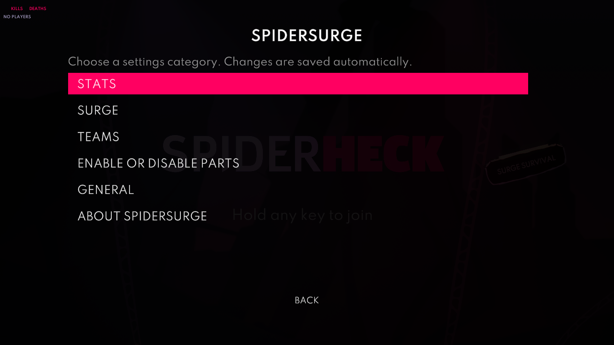

> **Not released yet.** This page describes what `main` holds now, which is not in a release yet. The [README](README.md) describes the latest release. When the next version is released, this file replaces `README.md`.

# SpiderSurge

**Abilities, live stats and team versus for SpiderHeck, all in one mod.**

SpiderSurge is made of four parts. Surge is played from its own lobby platform; the other parts can be turned on or off from the game's Mods menu.

| Part | What it does | On after installing |
|---|---|---|
| [Stats](stats/README.md) | Tracks kills, deaths, streaks and more in Survival and Versus, with live stats windows and fun titles after Survival runs | Yes |
| [Surge](surge/README.md) | A separate Surge Survival platform above and left of Wave Survival: new abilities, ultimates, perks and custom enemies | Yes |
| [Teams](teams/README.md) | Team versus: pick teams in the lobby, friendly fire rules, team colors and spawns, and Surge abilities in versus | No |
| [Game fixes](#game-fixes) | Fixes bugs in the base game | Yes |

Stats and Teams used to be separate mods, SpiderStats and SpiderTeams. They are now only released as parts of SpiderSurge.

## A look around

### Stats

A small live window sits in a corner of the screen while you play: each spider's kills and deaths, next to its color. It fades a spider's row while it's dead. Drag it anywhere with the mouse.

The big window is a full scoreboard: run time, enemies killed and a table with the columns you pick (totals, streaks, wave clutches, alive time, kills per enemy and per weapon, and more). Green is good, pink is a hit you took, amber is friendly fire.

When a run with two or more players ends, everyone gets fun titles based on how they played. The cards are revealed one by one in the lobby.

### Surge

New abilities and ultimates for Survival, perks that combine with the game's own, and new enemies. Each run starts with the team choosing its shared ability from cards before wave 1: 3 of them, or 2 from pain level 3. The ring over each spider drains while the ability is active and fills while it cools down, and a compact panel with a row for each player can replace the rings. Using the abilities fills the team's Surge meter, and a full meter is a chaos point to spend in a shop beside the perk cards, which sells two random items per perk screen out of a reroll, an extra life, a random perk, a bigger heart and a blood pact that trades a life for a chaos point. The perk screen shows the meter beside the cards, and a line under them says how the focused ability or ultimate charges it. With the perk timer off, a card click now only locks the card and a Confirm button under the cards makes the pick. The in-game guide explains all of it. It opens on the first launch, and you can find it in **Mods** > **SpiderSurge** > **Surge** > **Surge guide**, or press its key (backtick by default) to open it at any time.

### Teams

Split the lobby into teams and fight until one team is left standing. Spiders take their team's color, teammates spawn together, and the win screen shows each team's score.

### Settings in the game

Open **Mods** > **SpiderSurge** from the pause menu to turn parts on or off and configure Stats and Surge. Settings use the game's normal menu, with larger text and separate category pages. Navigate with the stick or D-pad, press A/Cross to select, and use left/right to adjust sliders. B/Circle, Start, Escape and the Back button return one page at a time, restoring your selection and scroll position.

Team versus, team count and friendly fire are on the normal **Versus Battle** setup page, above the versus presets. Scroll down for the other team options. They are also available on the custom versus page.

## Controls

| What | Keyboard | Controller |
|---|---|---|
| Small stats window | **F1** | D-pad (cycles the windows) |
| Big stats window | **F2** | |
| Titles | **F3** (also skips the reveal) | |
| Surge ability | **Q** | **L1**, or your own button: hold **Select** and double-tap it |
| Surge ultimate | **C** | **L3 + R3** together |
| Surge guide | **`** (backtick) | Pause menu > **Mods** > **SpiderSurge** > **Surge** > **Surge guide** |
| Switch team in the lobby | **T** | **Y / Triangle** |

Change any of them in **Mods** > **SpiderSurge** > **Controls**: select a row, then press the new key or button. The controller ultimate and the stats switch can also be two buttons pressed together or the whole D-pad. A row that shares a button with another one shows a warning, and a button that casts Surge's ultimate on its own doesn't also switch the stats windows.

## Installation

1. Install Silk Mod Loader: https://github.com/SilkModding/Silk
2. Download the `SpiderSurge.dll` from the [releases page](https://github.com/Dylan-Grinboju/SpiderSurge/releases) or build it from the source.
3. Place the `SpiderSurge.dll` into your Silk `mods` folder.
4. Launch the game.
5. Play Surge from its platform above and left of Wave Survival in the lobby. To turn on Teams, open the pause menu, pick **Mods** > **SpiderSurge** > **Enable or disable parts**, check **Teams**, and restart the game.

## Updating from SpiderStats or SpiderTeams

1. Delete `StatsMod.dll` and `SpiderTeams.dll` from the `Silk/Mods` folder, and replace an older `SpiderSurge.dll` with the new one.
2. Launch the game.

On the first launch, SpiderSurge moves your settings from `SpiderSurge.yaml`, `Stats_Mod.yaml` and `SpiderTeams.yaml` into the new `SpiderSurge.yaml`, and renames the old files to `.yaml.old`. Every part you had installed stays on, except Stats if you had turned its tracking off.

If `StatsMod.dll` or `SpiderTeams.dll` is still in the Mods folder, its part stays off, because both copies would change the game at once, and its settings file stays where it is until you delete the DLL. The same goes for Surge and an older standalone `SpiderSurge.dll` left next to the new one. With two copies of SpiderSurge that include the merged parts, only the first one runs. A popup lists the files to delete.

## Settings

### From the Mods menu:

Open the pause menu and pick **Mods** > **SpiderSurge**. The main page has:

- **Enable or disable parts**: a switch for each optional part. Turning a part on or off takes effect after restarting the game. Surge is always available from its lobby platform.
- Settings pages for Stats and Surge. Teams settings are on the versus setup page. Changes apply right away and are saved to the file.
- **Achievements**: Surge's achievements and the Stats title collection, each on its own page.
- **Controls**: every key and button the mod uses, on one page.
- **General**: check for updates, the telemetry settings, and reload edits to the settings file without restarting the game.
- **About SpiderSurge**: version and credits.

Stats columns are grouped by totals, enemy kills, weapon kills, shooting accuracy and player stats. Surge's ability indicator has its own page. Every reset asks for confirmation first.

### Using the Yaml file:

All the settings are in one file: `...\Silk\Config\Mods\SpiderSurge.yaml`. It has a section for each part (`stats`, `surge` and `teams`), plus:

`parts.stats`, `parts.teams`, `parts.fixes`: Turns each optional part on or off. Takes effect after restarting the game. Surge is always available through its lobby platform; older `parts.surge` and `surge.surgeMode` values are ignored.

`general.checkForUpdates`: If true, the mod checks for a new version when the game starts. Default: `true`.

`controls`: The keys and buttons of the **Controls** page, as Unity Input System paths such as `<Keyboard>/f1` or `<Gamepad>/buttonNorth`. `none` turns one off and `a|b` lets either one work. A controller control takes A, B, X, Y, L1, R1, L2, R2, L3 and R3, and a keyboard control any key but Escape; Start, Select and Escape stay with the pause menu and the ability remap. The controller ultimate and the stats switch also take `<Gamepad>/dpad` (any D-pad direction) and `a+b` (two buttons together). A value a control can't take is ignored, with a warning in the log, and the default is used. Older `surge.dpadUltimate`, `stats.input.cycleInput`, `teams.buttonGamepad` and `teams.buttonKeyboard` values move here on the first launch.

| Key | Default |
|---|---|
| `controls.ability.keyboard`, `controls.ability.controller` | `<Keyboard>/q`, `<Gamepad>/leftShoulder` |
| `controls.ultimate.keyboard`, `controls.ultimate.controller` | `<Keyboard>/c`, `<Gamepad>/leftStickPress+<Gamepad>/rightStickPress` |
| `controls.surgeGuide.keyboard` | `<Keyboard>/backquote` |
| `controls.stats.smallWindow`, `controls.stats.bigWindow`, `controls.stats.titlesWindow` | `<Keyboard>/f1`, `<Keyboard>/f2`, `<Keyboard>/f3` |
| `controls.stats.switchWindows` | `<Gamepad>/dpad` |
| `controls.teams.keyboard`, `controls.teams.controller` | `<Keyboard>/t`, `<Gamepad>/buttonNorth` |

Each part's page explains its own section. Edit the file while the game is closed, or use **Reload the settings file** afterwards. If a value is invalid, the mod uses the default instead and writes a warning to the Silk log. If the file itself can't be read, for example after a wrong indent, **Reload the settings file** keeps your current settings and shows the error; at launch, the mod starts with the defaults and keeps a copy of your file as `SpiderSurge.yaml.broken`. You can reset everything by deleting the file; it will be recreated with default values on the next launch.

## Saved progress

Surge achievements, the Stats title collection and Surge Survival highscores are saved together in one file on your PC, in the game's own save folder, so updating or reinstalling the mod or the game keeps them: `%USERPROFILE%\AppData\LocalLow\Neverjam Studio\SpiderHeckApp\SpiderSurge\progress.dat` for Steam (`...\SPIDERHECK\SpiderSurge\progress.dat` for the Xbox app). Each part has its own section, so turning a part off keeps its progress, and each reset button clears only its own progress.

Each save writes a new file and swaps it in, keeping the previous one as `progress.dat.bak`, so a crash mid-save loses nothing. The file carries a checksum: if it is damaged or edited by hand, the mod loads the backup instead and keeps the bad file as `progress.dat.broken`. While another program (OneDrive or an antivirus, say) holds the file open, achievements, titles and highscores earned meanwhile are kept and saved once it can be read, without lowering a highscore or showing an achievement you already have again.

Older versions kept the achievements and Surge highscores in the game's save and the titles in `titles.dat`. They move into `progress.dat` the first time the new version reads them, and the old copies are removed once the move is saved. The move happens only once, so an old copy that can't be removed doesn't bring reset progress back.

## Online play

Every player needs the same SpiderSurge version, and the lobby must use P2P. The host turns away anyone without SpiderSurge or with another version.

## Game fixes

- Every controller can pause, even while another controller is sending input.
- Reconnecting a controller keeps its original spider instead of adding a second player controlled by the same gamepad.
- Whisps no longer shoot the moment they spawn.
- Off-screen enemy arrows no longer throw an error every frame after their enemy dies in lava.
- Pain-level colour unlocks no longer throw an error on every lobby load, and every earned colour unlocks instead of only the first.
- Starting the game no longer throws the custom-maps warning error twice.

## Building and releasing

`dotnet build -c Release` makes `bin/Release/net472/SpiderSurge.dll`. The version comes from the latest `vX.Y.Z` git tag through [MinVer](https://github.com/adamralph/minver), so the code holds no version number to edit. A build after `v0.4.0` is `0.4.1-dev.N`, and the update check counts it as older than the release with the same number. A build without the git history (a source zip) is `0.0.0-dev`. Only GitHub Actions makes release builds: a build made anywhere else ends in `+local`, even on a release tag (`0.4.0+local`), so runs from testing can be told apart in telemetry.

To release, first replace `README.md` with this file, without the note at the top, so the README describes the new release. Then publish a GitHub release with a new `vX.Y.Z` tag. The Build workflow builds `SpiderSurge.dll` from that tag and attaches it to the release. The update check reads the latest published release, so players are offered the new version from then on; drafts and pre-releases are not offered. `version.txt` is only for players on 0.4.0 or older, whose update check reads it from `main`. Set it to the first release made this way once that release is published, then leave it.

## Other Mods

- **[InfiniteFriends](https://github.com/Dylan-Grinboju/InfiniteFriends)**: Raises the player limit to 32. Teams works with it.
