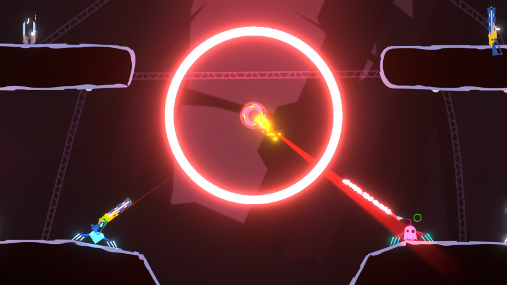
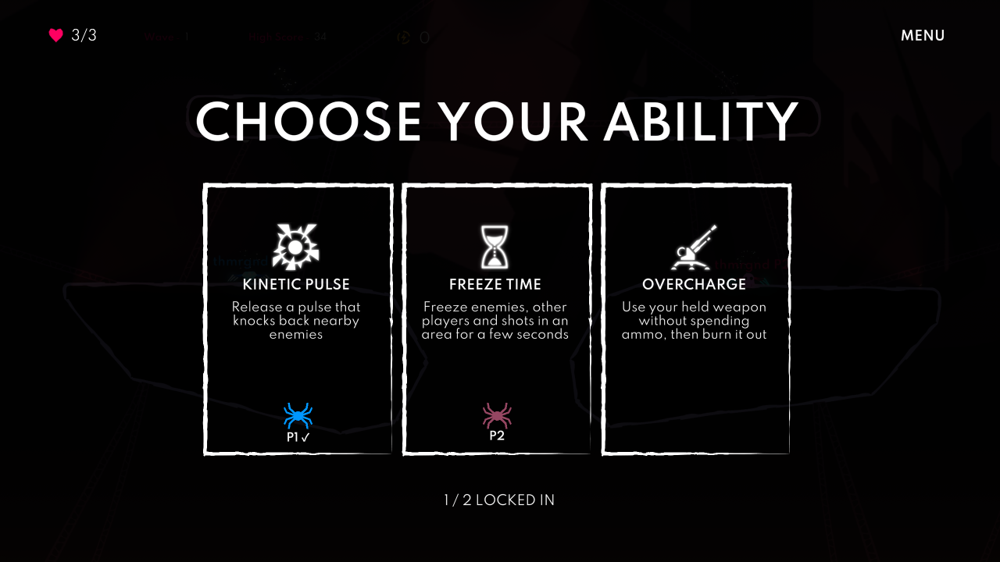
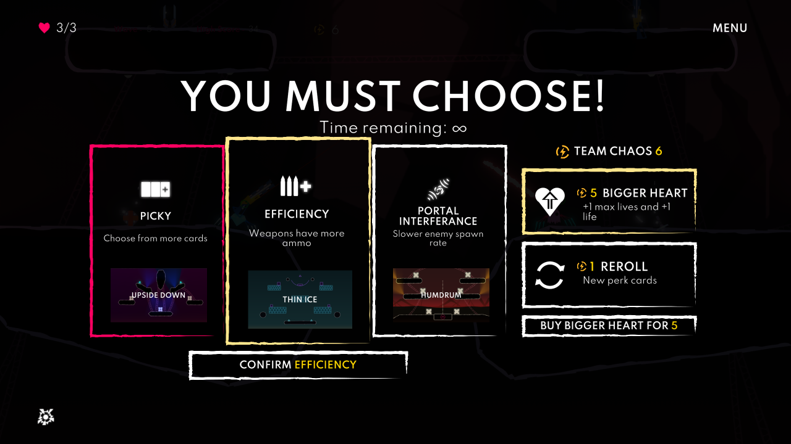
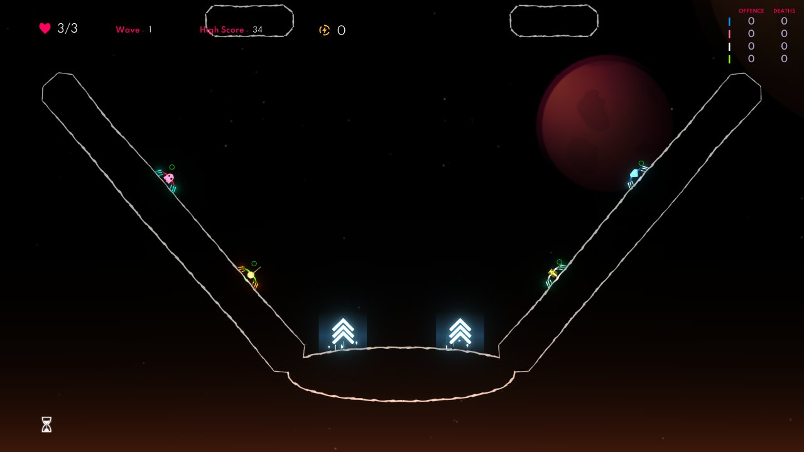
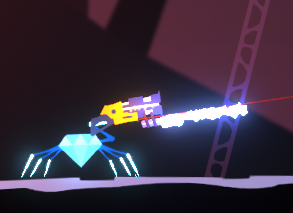

# SpiderSurge

**Abilities, new arenas and weapons, live stats and team versus for SpiderHeck.** 🕷️

SpiderSurge 1.0 brings **SpiderStats into the mod** and adds **team versus**, alongside new maps, weapons, abilities and plenty of ways to make questionable decisions with your friends. Jump into Surge Survival, split into teams for Versus, or keep ordinary Survival and enjoy the stats.

**Online support is experimental.** Use a **P2P lobby**, with **the same SpiderSurge version on every player's PC**. Please report desyncs, late-join problems and anything else that looks wrong. See [Online play](#online-play) for details.

[Download SpiderSurge](https://github.com/Dylan-Grinboju/SpiderSurge/releases) · [Release notes](https://github.com/Dylan-Grinboju/SpiderSurge/releases) · [Ideas, feedback and bugs](https://github.com/Dylan-Grinboju/SpiderSurge/issues)

## What's in the mod

| Part | What it adds | How to play |
| --- | --- | --- |
| [Surge](surge/README.md) | Personal abilities and ultimates, new enemies, 11 arenas, four weapons, Chaos challenges and a shop | Use the **Surge Survival** platform above and left of Wave Survival |
| [Stats](stats/README.md) | Live scoreboards, Survival titles, a title collection and match history | Tracks Survival and Versus automatically; use F1 and F2 for the windows |
| [Teams](teams/README.md) | New team-versus mode, team scores, colours and friendly-fire rules | Turn on **Team versus** on the Versus setup page |
| [Game fixes](#game-fixes) | Controller, enemy, menu and scoring fixes for the base game | On by default; configurable under Settings > Advanced |

Surge, Stats and Teams load together in one `SpiderSurge.dll`. Normal **Wave Survival** remains available on its own platform. Team versus starts off on new installs, and Stats windows and titles can be hidden in Settings.

## Installation

1. Install [Silk 0.7.0](https://github.com/SilkModding/Silk).
2. Download **SpiderSurge.dll** from the [releases page](https://github.com/Dylan-Grinboju/SpiderSurge/releases).
3. With the game closed, put it in `Silk/Mods` inside the game folder, replacing your old SpiderSurge DLL.
4. Launch the game. Open **Mods > SpiderSurge** from the pause menu for settings, collections and match history.

### Coming from SpiderStats?

Stats is now included in SpiderSurge. **Remove the standalone `StatsMod.dll`, including renamed copies, and restart.** You can switch directly to Surge without installing the final standalone Stats migration update first.

Your supported old settings migrate automatically into `Silk/Config/Mods/SpiderSurge.yaml`; old standalone configuration files are kept as `.yaml.old` backups. If you previously disabled Stats tracking, its windows and title cards start hidden, while tracking runs for Surge.

**If an extra Stats instance remains installed, a popup names the files to remove.** Integrated Stats stays off and its old settings stay in place until you remove the extra mod and restart. Keep only one SpiderSurge DLL too. Store DLL backups outside the active Mods folders or in `Silk/Mods/Disabled`.

## Surge Survival ✨

Each player chooses their own starting ability from shared offers, then their own ultimate after wave 30. Mix and match, or double up with a friend. Abilities include Null Field, Overcharge, Kinetic Pulse, Pocket Dimension and Freeze Time; ultimates include Neural Backup, Care Package, Thermal Detonation, Black Hole and Rewind.

- **11 new arenas**, with portals, vents, jump pads, moving machinery and even zero gravity. They join Surge's map choices; ordinary Survival and Versus retain their original map lists.
- **Chaos challenges and a shop.** Choose marked maps, accept optional challenges, and spend shared points on perks, healing and extra life capacity. Chaos Cartographer and Challenge Seeker improve your rewards.
- **New enemies**, including Twin and Missile Whisps, Wasp Cocoons that hatch reinforcements, and laser enemies whose red shields power a damaging ring.
- **Pain 8**, for anyone who thought the existing pain levels were being too polite: starting ultimates and double normal wave enemies.
- **25 achievements**, plus a compact run recap of your build, challenges and Chaos spending.
- **Separate high scores** for Surge. Normal Survival scores stay separate, and Surge runs are not submitted to the game's online leaderboards.

See the [Surge guide](surge/README.md) for abilities, perks, enemy behaviour, achievements and tuning.

### New weapons

| Weapon | What it does |
| --- | --- |
| **Bayonet** | A rare Baby Shotgun with a Particle Blade attached. Fire it, stab with it, or keep using whichever half still has something left |
| **Daze Dart** | Three arcing darts, one per shot, that daze enemies and spiders for five seconds |
| **Repulsor** | Three charges of cone-shaped knockback. Push enemies, spiders and loose objects away |
| **Poison Grenade** | A green, beeping grenade that leaves a five-second poison cloud |

Each weapon has its own Versus selection option.

*The Bayonet. Sometimes the shotgun needs a second opinion.*

## Stats and collections

**SpiderStats is built in and expanded.** The small window shows each spider's offence and deaths; the full scoreboard adds streaks, shooting accuracy, weapon offence, enemy breakdowns, movement and time alive. Choose a preset or customise your own columns.

Survival runs with two or more players, local or online, end with fun titles based on how everyone played. Earned titles join a persistent collection. Versus has its own results without Survival title cards.

**Match history** keeps Survival and Versus results, with Surge filters and details for players, maps, perks, accuracy and titles. Online guests see results, but completed match history and title-collection unlocks are saved on the **host PC**.

Open **Mods > SpiderSurge > Collection** for titles and Surge achievements, or **Match history** for past games. The [Stats guide](stats/README.md) explains the windows, statistics and records.

## Team versus

Split the lobby into teams and fight until one team is left standing. Teammates spawn near each other, share team scores and can use team colours and markers. Friendly fire can **Push**, **Ignore** or **Damage** teammates.

Turn on **Team versus** on the normal Versus setup page. Pick a team with **T** or **Y / Triangle** in the versus waiting room; offline local play also supports choosing in the main lobby. Late arrivals join the smallest team.

You can also enable Surge abilities in team versus or free-for-all. For larger groups, [InfiniteFriends](https://github.com/Dylan-Grinboju/InfiniteFriends) raises the player limit to 32. See the [Teams guide](teams/README.md) for the full rules and options.

## Online play

**Online support is experimental in 1.0.** Every player must run the same SpiderSurge version in a **P2P lobby**. A modded host refuses players without SpiderSurge or with a different version.

The host controls shared rules and team decisions. Guests can see results, but completed match history and title-collection unlocks stay on the host PC. Online play still needs more real-world testing; [send feedback or report a bug](https://github.com/Dylan-Grinboju/SpiderSurge/issues), especially if something differs between host and guest.

## Controls

| Action | Keyboard | Controller |
| --- | --- | --- |
| Small stats window | **F1** | **D-pad** cycles the available windows while menus are closed |
| Big scoreboard | **F2** | Available in the lobby's window cycle |
| Survival titles / skip reveal | **F3** | Available in the lobby's window cycle |
| Previous / next scoreboard page or preset | **Page Up / Page Down** | **D-pad left / right** while the big window is open |
| Surge ability | **Q** | **L2** |
| Surge ultimate | **C** | **L3 + R3** together |
| Switch team in the lobby | **T** | **Y / Triangle** |

The controller ability button replaces its normal game action, so use **A or L1 to jump**. To remap it, hold **Select** and double-tap another button. Release Select, then hold it for three seconds to reset to L2. Each player chooses their own binding; it lasts until they leave the game.

During a match, the controller window cycle offers the small window and Off. In the lobby, it also offers the big scoreboard and Survival titles. The scoreboard's arrows and mouse wheel move through its pages and presets too.

## Settings

Open **Mods > SpiderSurge > Settings**. The menus work with mouse, keyboard and controller, with explanations beside the selected setting. Changes save automatically.

- **Brightness:** adjust your display from 50% to 200%.
- **Survival:** choose whether shared perk choices have a time limit. With unlimited time, select a card and press Confirm.
- **Stats:** choose a scoreboard preset, customise columns, resize the windows or hide stats and titles.
- **Surge:** choose ability rings or a corner panel, adjust effects and sound, and configure run rules.
- **Records and privacy:** control match history, detailed text exports and anonymous run reports separately.
- **Advanced:** manage updates, game fixes and manual config reload.

Team rules are on the **Versus setup page**. Collection and Match history are on the main SpiderSurge menu; version, credits, logs and diagnostics are under **About SpiderSurge > Support**.

All settings are stored in `Silk/Config/Mods/SpiderSurge.yaml`, with `stats`, `surge` and `teams` sections. Edit it while the game is closed, or use **Reload the settings file** afterwards. Invalid values fall back to defaults. If a reload cannot read the file, your current settings are kept; an unreadable file at startup is backed up as `SpiderSurge.yaml.broken`.

See the [Stats](stats/README.md#how-to-configure-stats), [Surge](surge/README.md#how-to-configure-surge) and [Teams](teams/README.md#how-to-configure-teams) guides for individual settings.

## Updating

Open **Mods > SpiderSurge > Settings > Advanced > Updates** to check for a release, read its notes and download it. With update checks enabled, the mod also offers new releases shortly after startup when you are in the lobby.

Downloads and pending installs can be cancelled. A verified update installs after the game closes; launch again once installation finishes. Settings and progress are kept. The previous DLL is saved at `Silk/Mods/Disabled/SpiderSurgeUpdate/previous.dll` for rollback. Releases without a verified download can be installed manually.

Want faster, riskier updates? Install a beta DLL manually from its [pre-release page](https://github.com/Dylan-Grinboju/SpiderSurge/releases). Beta installations receive newer betas as well as stable releases; installing a newer stable release returns you to stable updates. Every online player must update to the same version.

## Saved progress

Surge achievements, the title collection and Surge high scores share a local `progress.dat` file, with a `progress.dat.bak` backup and recovery for damaged files. Supported older progress migrates automatically. Match history lives in the adjacent `History` folder; clearing it keeps achievements, titles and high scores.

The Steam folder is `%USERPROFILE%\AppData\LocalLow\Neverjam Studio\SpiderHeckApp\SpiderSurge`; the Xbox app uses `SPIDERHECK` in place of `SpiderHeckApp`. Each collection's reset clears only its own progress.

## Game fixes

These fixes for the base game are enabled by default:

- Any controller can pause mid-game, and a reconnected gamepad keeps its original player.
- Whisps respect their spawn shot cooldown.
- Dead off-screen enemies no longer generate repeated indicator errors.
- Pain-level colour unlocks work without repeated lobby errors, and custom-map warning startup errors are fixed.
- Timed-out perk/map selection can choose the last card.
- Shotguns can use their full firing and impact sound sets.
- A hidden connecting screen no longer blocks returning to the lobby.
- Tiers of Heck and Parkour no longer overwrite or submit scores for the last Survival pain level.
- Weapons drop correctly when Astral Heckhound expires.

## Help shape what comes next 💬

You can send **ideas, feature requests, feedback and bug reports** through [GitHub Issues](https://github.com/Dylan-Grinboju/SpiderSurge/issues). For a bug, include your mod version, whether you played locally or online, whether you were host or guest, what happened, and useful logs or screenshots.

**Please turn on telemetry: Mods > SpiderSurge > Settings > Records and privacy > Share anonymous run reports.** These reports are important for balancing abilities, weapons, enemies, maps and Chaos rewards around real runs.

Sharing is optional and off until you agree. Reports use a random anonymous ID and player slots rather than player names. You can turn sharing off again at any time, and it does not require saving local text exports. See [Telemetry](surge/README.md#telemetry) for what is sent.

Thanks for playing, testing and finding increasingly creative ways to fall into lava.

## Building and credits

Build with `dotnet build -c Release`; the DLL is written to `bin/Release/net472/SpiderSurge.dll`. Versions come from Git tags through MinVer, and local builds carry a `+local` suffix. See [Building and releasing](docs/RELEASING.md) for the release process.

Credits are available in **About SpiderSurge** and the [icon credits](docs/ICON_CREDITS.md).
