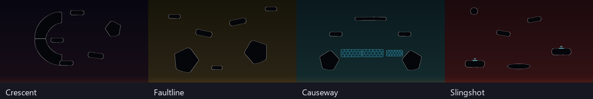

# Surge map design

The base game's black silhouettes, thin illuminated edges, subdued backgrounds and bright interactive objects are the reference. Its arenas usually have a strong overall shape with generous gaps for webs, thrown weapons and flying enemies. Symmetry is common, but it is not a requirement: the additions should offer useful movement choices rather than resemble detailed models of real structures.

The original 16 maps already use native materials and backgrounds. Aqueduct, Zigzag, Stairwell, Thin Ice, Cactus Garden, Caldera, Trampoline, Geysers, Colonnade, Jaws and Satellite keep their identities. Five layouts needed a clearer movement structure:

| Arena | Revision | Reason |
|---|---|---|
| Fallen Blocks | Seven irregular slabs and rocks replace the tetromino assemblies. | Removes the visual reference to another game and reduces small seams. |
| Truss Bridge | Two broken abutments, an upper span and a lower recovery ledge. | Removes closed triangular compartments; the center is a crossing instead of a wall. |
| Crossbeams | Four separated arms frame an open center. | Allows travel between quadrants without circling the entire X. |
| Ladders | Broken single spines and alternating ledges replace two enclosed rung grids. | Preserves vertical climbing while opening side exits. |
| Pipeworks | A gap in the bottom and suspended inner pipes; single continuous straight segments. | Opens an escape below each pocket and removes repeated joins. |

The four additions complement the base catalog as well as the original PR. They reuse existing mechanics; their contribution is the arrangement and the choices it creates.

| Addition | Closest base-game reference | Distinct role |
|---|---|---|
| Crescent | Core / Rock Loop's curved silhouettes | A one-sided crescent under normal gravity, with an open mouth facing detached islands. Shelter and open air occupy different halves. |
| Faultline | Smash's separated footholds / Ant Domain's angular rocks | Unequal rock banks and diagonal upper ledges frame an exposed ravine. The rare weapon sits on a lower recovery shelf. |
| Causeway | Float / Floating Nightmare's fragile footing | A breakable direct crossing between durable spawn islands, with permanent upper ledges after the shortcut is destroyed. Only the optional rare weapon sits on the fragile route. |
| Slingshot | Bouncer's jump pads | Two exposed launch islands at different heights, with staggered upper footholds and a low central recovery platform. Spawns are beside the pads, not directly over them. |

Base-game arenas remain in Surge's pool. These maps do not replace their geometry or change their behavior; normal Wave Survival and Versus keep their original pools.



All 20 cards use consistent geometry previews: native collider silhouettes, subdued biome colors, orange hazards, cyan ice and pad/vent markers. These are diagrams, not gameplay captures; they omit scenery, weapons and players. Regenerating them from the layouts keeps the card's shape accurate after an edit.

## Authoring and validation

`surge/Maps/Tools/layouts.py` is the source for the embedded JSON. Extract current collider outlines with `shapes.py`, then run:

```powershell
python surge/Maps/Tools/shapes.py <scratch> --scenedump <workspace>/SceneDump
python surge/Maps/Tools/layouts.py --shapes <scratch>
python surge/Maps/Tools/thumbnails.py <scratch>
```

The checker rejects unknown collider data, unsupported spawn positions, solid overlaps, hazard footing, and insufficient enemy clearance. A failure returns a nonzero exit code before writing layouts. `--only id,id` validates and writes only those maps. `--preview` also draws collider diagrams and requires matplotlib.

The thumbnail renderer requires Pillow (available in the workspace's SceneDump environment), validates all maps before writing, and produces 320 × 180 PNGs. It changes only card artwork; the playable maps still use the game's actual prefab materials and backgrounds.

These are static placement checks. They do not establish reachability, pad trajectories, destruction behavior, camera framing or online synchronization; those require gameplay observation. Changes to an arena also require a matching thumbnail, since the card should show its actual shape.
