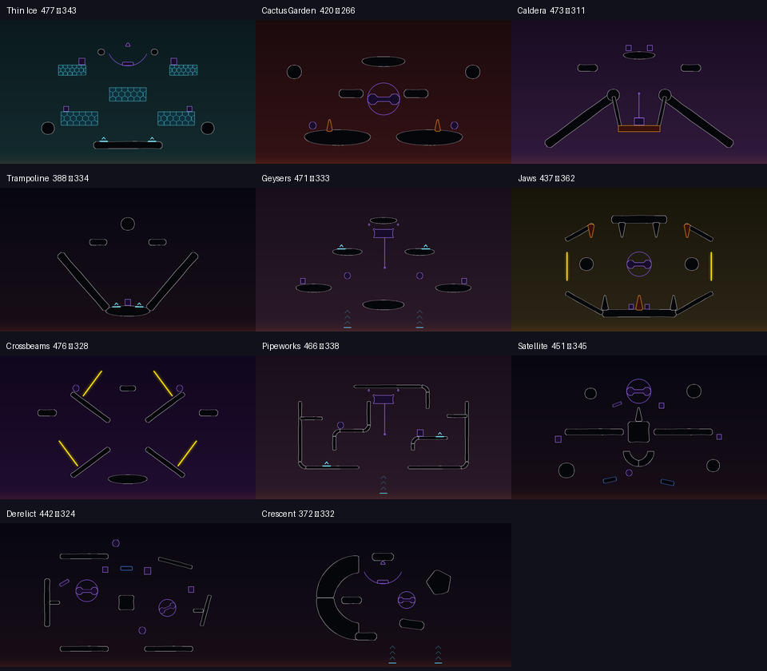

# Surge map design

The base game's black silhouettes, thin illuminated edges, subdued backgrounds and bright interactive objects are the reference. Its arenas usually have a strong overall shape with generous gaps for webs, thrown weapons and flying enemies. Symmetry is common, but it is not a requirement: the additions should offer useful movement choices rather than resemble detailed models of real structures.

The selection contains 11 arenas. Each earns its place through a recognizable silhouette or movement mechanic, rather than another arrangement of detached platforms.

| Arena | Distinct role |
|---|---|
| Thin Ice | Breakable shelves disappear above a permanent recovery floor, whose jump pads fire up through the shelf gaps; two small footholds sit above the top shelves. |
| Cactus Garden | Exposed islands with lethal cacti make low footing hazardous. |
| Caldera | Outer slopes surround a central lava crater. |
| Trampoline | A deep bowl funnels players toward jump pads at its base. |
| Geysers | Air vents beneath floating shelves provide recovery from below; jump pads on the shelves above them launch higher. |
| Jaws | Opposing toothed surfaces frame a horizontal arena with lava above and below. The upper jaw is open at its corners, its outer teeth and the lower middle tooth burn, and gates in the open sides wrap one side to the other. |
| Crossbeams | Four separated diagonal arms leave an open central crossing; gates join each lower tip to the opposite upper tip. |
| Pipeworks | Interrupted pipes form pockets with multiple exits; a vent lifts spiders through the central gap and jump pads fire up the clear shafts on each side. |
| Satellite | Long wings divide upper and lower routes around a central body and dish, with drifting debris below, all in zero gravity. |
| Crescent | A large curved wall shelters one side while detached islands expose the other; vents under the open side lift fallen spiders back up. |
| Derelict | A broken station hull in zero gravity: plates with open corners around a core, two turbines inside, a lift rising through the floor gap and cargo floating loose. |

Ten layouts were removed from the original 20-map selection:

| Removed | Reason |
|---|---|
| Fallen Blocks, Faultline, Slingshot | These and Crescent repeated the scattered-island arrangement. Crescent remains as the strongest silhouette; Trampoline already supplies jump-pad play. |
| Stairwell | Another sequence of detached footholds; Ladders gives climbing a clearer structure. |
| Truss Bridge | Its split bridge and upper crossing overlapped the architectural identity of Aqueduct. |
| Causeway | Its breakable crossing overlaps Thin Ice, which makes destruction the defining feature across several shelves. |
| Aqueduct, Zigzag, Colonnade, Ladders | Removed after play feedback. |

## Size

The custom map scene gives every map the same 930 × 530 camera box, about three times the area of a typical base-game arena (median 498 × 354 across the 34 arenas in the endless survival pool). The Surge maps therefore follow the base game's proportions instead:

- **Camera box:** each layout stores a box fitted to its colliders and vents, reaching 25 past the sides, 30 below and 65 above, the base-game arenas' median margins. Host and clients apply it when the map loads, so the camera no longer follows players into empty space or zooms out further than on a base-game arena.
- **Enemy spawns** lie inside that box, as they do on the base-game arenas. Before, they sat up to 110 units outside the outermost platforms.
- **Player spawns** are at most 500 apart; the widest base-game spread is 511.
- **Scale:** `surge_map(..., scale=f)` shrinks a whole arena toward (0, -150). Spawns, jump pads (whose force is fixed) and portals keep their size. Eight arenas are scaled from 0.75 to 0.9, so the selection runs from compact (Crescent 494 and Trampoline 511 wide) to large (Thin Ice 762), with a median of about 670 × 440.

| Arena | Scale | Camera box |
|---|---|---|
| Thin Ice | 1 | 762 × 500 |
| Cactus Garden | 0.75 | 584 × 342 |
| Caldera | 0.85 | 670 × 409 |
| Trampoline | 0.75 | 511 × 420 |
| Geysers | 0.85 | 668 × 442 |
| Jaws | 0.9 | 630 × 496 |
| Crossbeams | 0.85 | 675 × 436 |
| Pipeworks | 0.9 | 674 × 457 |
| Satellite | 1 | 718 × 509 |
| Crescent | 0.8 | 494 × 421 |
| Derelict | 1 | 670 × 465 |

Jump pads keep their force on a scaled map, so they throw relatively higher: on Trampoline a pad launch peaks at y 117, level with the upper platforms and well inside the 236 camera top.

## Spawn supply

The vanilla endless survival pool contains 34 arenas, averaging 7 weapon points and 6.12 enemy points; 31 of those arenas have exactly 6 enemy points. Across all 55 vanilla arenas the averages are 7.04 weapons and 6.02 enemies. Counts include active, enabled weapon spawners and active objects tagged `EnemySpawn`, excluding lobby and parkour scenes.

Every Surge arena has **6 regular weapon points, 1 rare weapon point and 6 enemy points**. The new weapon points cover lower recovery routes, intermediate footing and upper platforms. Trampoline gets two points at the foot of the bowl and two along its slopes, in addition to the upper pair and rare point. Thin Ice keeps two regular points over its permanent floor after the shelves break.

Every geometry supports this supply without additional platforms. Weapon points stay at least 60 units apart; enemy points stay at least 90 apart and 60 from initial player spawns. The checker rejects insufficient counts, stacked points and missing weapon supply near the lowest player route, in addition to its existing footing, hazard, gadget and camera checks. An arena that cannot meet these requirements within its intended geometry should be removed from the roster.

## Gadgets

The map editor's gadgets give several arenas a movement idea beyond their silhouette. They are the game's own networked elements, so the host runs them and clients see the result.

| Gadget | Editor name | Behavior | Used on |
|---|---|---|---|
| Jump pad | Booster (`Jump Pad`) | Launches spiders and enemies along its up direction | Trampoline, Thin Ice, Geysers, Pipeworks |
| Vent | Aero Tube (`AeroTube`) | Slows anything entering its column and lifts it about 120 units per scale | Geysers, Pipeworks, Crescent |
| Hover pad | Floating Platform (`FloatingPlatformWide Variant`) | Solid, without gravity; drifts when pushed or stood on and does not return to its place | Satellite |
| Gate | Portal Line (`PortalLine` with a linked `PortalLine Variant`) | A 75-unit line that moves spiders, enemies and loose weapons to the same point on the other gate, keeping their velocity | Jaws, Crossbeams |

Gates are the portals the base-game arenas use, such as Rock Loop's. The editor's Portal Point is only a small swirl that cannot be scaled and reads as a dot in play, so the Surge maps no longer use it. Each gate pair shares one rotation, so velocity passes straight through.

Portals make an arena harder: enemies can arrive through them, and a spider keeps its speed on the far side. They are therefore limited to non-beginner maps and placed so that each exit leads back into the arena:

- Every exit has solid, non-hazard footing within 80 units below its lowest end, so falling into one end lands on ground at the other.
- Gates keep 45 units from player and weapon spawns and 35 from enemy spawns along their whole length, do not touch solids, and stay away from the lava. A gate may stand on a beam.
- On Jaws, vertical gates in the open sides wrap a spider from one side to the other without filling the mouth. On Crossbeams, each gate stands across a lower arm near its tip, so sliding down into it drops a spider onto the opposite upper arm, sliding inward.

Hover pads are never spawn footing, because they drift. Jump pads sit on solid ground away from spawns, at the editor's size, so they look like the base game's pads.

### Moving parts

Most base-game arenas have something that moves or can be pushed: 76% of the endless survival pool has moving or physics platforms, against 1 of the 10 Surge maps before these parts. Every Surge arena now has some. They are the base game's own networked level prefabs, which the map editor cannot place, so `SurgeParts.cs` spawns them on the host after the map is built, from each layout's `parts` list.

| Part | Prefab | Behavior | Used on |
|---|---|---|---|
| Crate | `Box A`, `Box B`, `Box Wide` | Loose physics box, pushed by spiders, shots and explosions | Thin Ice, Caldera, Trampoline, Geysers, Jaws, Pipeworks, Satellite, Derelict |
| Ball | `Ball` | Loose rolling ball | Cactus Garden, Geysers, Crossbeams, Pipeworks, Satellite, Derelict |
| Turbine | `Big Spinner` | A beam on a center hinge; free, or turned by a motor at the layout's `motor` degrees per second | Cactus Garden, Trampoline, Jaws, Crossbeams, Satellite, Crescent, Derelict |
| Swing | `Swing` | A plank on two ropes under a fixed anchor | Thin Ice, Crescent |
| Cage | `DescendingCage` | Sinks about 128 below its hooks and rises again, waiting 2 seconds at each end | Geysers, Pipeworks |
| Lift | `Moving Platform B` | Rises 108 along its up direction while something stands on it, then returns | Caldera, Derelict |

- **Network:** the prefabs are already registered network prefabs, so the host's spawn reaches clients with no new messages. Their own components carry scale, body motion and joints. The host sets only physics that the client copies cannot fight: motors, shortened ropes and cage travel.
- **No respawn:** the base game's crates and balls are indestructible, so lava does not remove them, and nothing brings back one that falls through it. Surge keeps that: a crate or ball lost to the lava, or drifting off in zero gravity, stays gone until the next map.
- **Size:** parts never widen the camera box, which stays fitted to the static geometry. The checker sweeps every moving part through its motion and keeps it inside the box, clear of solids, other parts, spawns (22 from player and weapon points, 30 from enemy points), portals and pads. Loose parts only need to start clear, with footing or a vent below on a gravity map. Swings and cages hang, so they need gravity and no rotation.
- The small `Spinner`, `SuspendedPrism` and `HingePlatform` are also supported, though no layout uses them yet. Danger and hammer spinners and the Tumbler are not: the danger spinner hurts only spiders, the hammer's clockwork motor fights the client's sync, and the Tumbler is too large for these arenas.

Satellite and Derelict are the zero-gravity arenas. Their layouts set the game's own `zeroGravity` level flag, so it behaves like the base game's space arenas for host and clients. No Surge map is marked beginner-friendly.

Base-game arenas remain in Surge's pool. These maps do not replace their geometry or change their behavior; normal Wave Survival and Versus keep their original pools.



All 11 cards use consistent geometry previews, each framed to its map's camera box: native collider silhouettes, subdued biome colors, orange hazards, cyan ice, pad/vent markers, blue hover pads, yellow gate lines and violet moving parts, with a faint circle, arc or line for how each one moves. These are diagrams, not gameplay captures; they omit scenery, weapons and players. Regenerating them from the layouts keeps the card's shape accurate after an edit.

## Authoring and validation

`surge/Maps/Tools/layouts.py` is the source for the embedded JSON. Extract current collider outlines with `shapes.py`, then run:

```powershell
python surge/Maps/Tools/shapes.py <scratch> --scenedump <workspace>/SceneDump
python surge/Maps/Tools/layouts.py --shapes <scratch>
python surge/Maps/Tools/thumbnails.py <scratch>
python tests/MapSpawns.Tests.py
```

`--shapes` is required, because the camera boxes are fitted to the collider outlines. The checker rejects unknown collider data, unsupported spawn positions, solid overlaps, hazard or hover-pad footing, insufficient enemy clearance, moving parts that hit solids, each other, spawns, portals or pads or leave the camera box, loose parts without footing on a gravity map, enemy spawns outside the camera box, player spawns more than 500 apart, unpaired portals, gates whose exit turns what passes through, portals on beginner maps or without footing below their exits, and jump pads without footing. A failure returns a nonzero exit code before writing layouts. `--only id,id` validates and writes only those maps. `--preview` also draws collider diagrams and requires matplotlib.

The thumbnail renderer requires Pillow (available in the workspace's SceneDump environment), validates all maps before writing, and produces 320 × 180 PNGs. It changes only card artwork; the playable maps still use the game's actual prefab materials and backgrounds.

These are static placement checks. They do not establish reachability, pad trajectories, destruction behavior, how the camera frames play or online synchronization; those require gameplay observation. Changes to an arena also require a matching thumbnail, since the card should show its actual shape.
