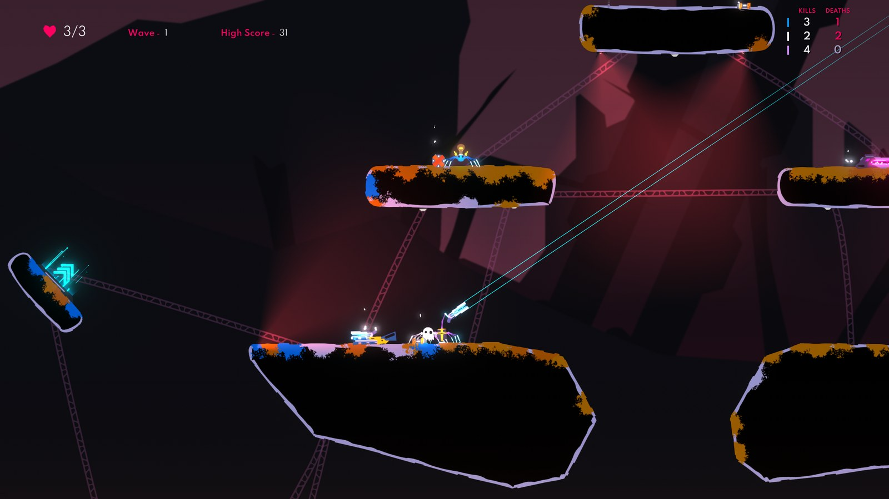

# Stats

The Stats part of [SpiderSurge](../README.md): statistics tracking that monitors player performance and game events. It used to be a separate mod, SpiderStats.

Stats is on after installing SpiderSurge. You can turn it off from the pause menu, under **Mods** > **SpiderSurge**.

## Features

- **Extensive Player Statistics**: Tracks a wide range of player stats including kills, deaths, friendly kills, shield interactions, web swings, airborne time, kill streaks, enemy-specific and weapon-specific kills.
- **Player Titles**: At the end of each Survival run, players are awarded fun titles based on their performance (e.g., "The Survivor", "Phantom Blade", "Lone Wolf"). Titles stay hidden during and after Versus matches, with or without teams.
- **Shooting accuracy**: Optional overall and per-weapon accuracy columns in F2, with successful/fired shot counts in saved stats, and accuracy titles such as "Bullseye", "Bullet Time" and "Stormtrooper". Each shot counts once, including pellet volleys and sustained beams. See [definitions, supported weapons and implementation research](../docs/weapon-accuracy.md).
- **In-Game Display**: 
  - Press **F1** to toggle the small stats display window. You can click and drag this window to reposition it
  - Press **F2** for the large stats overlay
  - Press **F3** to view player titles after a Survival run
  - Press **D-pad** on a controller to cycle the UIs
  - Change these keys in **Mods** > **SpiderSurge** > **Controls**. A button that also casts Surge's ultimate on its own casts the ultimate and doesn't switch the windows
- **Log File**: All the stats are saved to a local txt file when the game ends 
- **Configurable**: Every setting can be changed from the Mods menu or the Yaml file
- **Versus Mode Support**: Opponent kills count toward Kills, Total Offence, kill streaks and weapon stats. Breaking an opponent's shield counts toward Enemy Shields and Total Offence. With Teams on, only teammate kills and shield breaks count as friendly fire; without teams, every other spider is an opponent. Solo kills and streaks mean no living teammates, even while opponents are alive.

### Small window (F1)
Each spider's kills and deaths, next to its color. A dead spider's row fades until it respawns. Turn on `stats.display.smallUIShowBackground` for a dark panel behind it.

### Big window (F2)
The run time, enemies killed and a table with the columns you pick. Green is good, pink is a hit you took, amber is friendly fire, and zeros are dimmed. If the columns don't fit on the screen, the window shrinks to fit. In versus it shows the match time instead.

### Titles (F3)
Shown in the lobby when a run with two or more players ends. The cards are revealed one by one; press F3 to show them all at once.

### Title collection
Every title that shows on the end screen unlocks in your collection. Open it from **Mods** > **SpiderSurge** > **Achievements** > **Titles** to see the titles you have unlocked, how many runs you earned each one in and when you first got it, and the ones still locked. Click a locked title (or press A on it) to see what it takes to earn it. Surge mode's titles are listed while the Surge part is on. **Reset the title collection** at the bottom of the page locks every title again.

The collection is saved on your PC in the game's own save folder, so updating or reinstalling the mod or the game keeps it: `%USERPROFILE%\AppData\LocalLow\Neverjam Studio\SpiderHeckApp\SpiderSurge\progress.dat` for Steam (`...\SPIDERHECK\SpiderSurge\progress.dat` for the Xbox app). That file also holds Surge's achievements and highscores; the collection is only title names, counts and dates. Each save writes a new file and swaps it in, keeping the previous one as `progress.dat.bak`, so a crash mid-save loses nothing. The file carries a checksum: if it is damaged or edited by hand, the mod loads the backup instead and keeps the bad file as `progress.dat.broken`. Older versions kept the collection in `titles.dat` in the same folder; it moves into `progress.dat` on the first launch, and `titles.dat` is removed once the move is saved.

## How to configure Stats

### From the Mods menu:

Open the pause menu and pick **Mods** > **SpiderSurge** > **Stats**. Changes apply right away. The page has every setting below except the small window's position, which you set by dragging it, the big window's columns on their own page, and **Reset Stats settings to defaults**, which keeps the small window's position.

### Using the Yaml file:

Stats' settings are the `stats` section of `...\Silk\Config\Mods\SpiderSurge.yaml`. See [Settings](../README.md#settings) for how the file works.

Explanation of the fields

### UI:
`stats.display.showStatsWindow`: shows the mod UI. If false, pressing F1 or F2 does nothing; F3 still shows the titles. Note that the tracking will still work, it will just not show you anything.

`stats.display.showPlayers`, `stats.display.showPlayTime` and `stats.display.showEnemyDeaths`: Exactly what it sounds like. Will hide/show the corresponding parts of the Big UI.

`stats.display.autoScale`: If true, the mod will automatically scale the UI based on your screen resolution.

`stats.display.uiScale`: You can use this to manually scale the UI, from 0.5 to 3. 1 is normal size, 2 is double size, 0.5 is half size and so on. You can use this in conjunction with autoScale or by itself.

`stats.display.bigUIOpacity`: Controls the transparency of the Big UI overlay (F2). Values range from 0 (fully transparent) to 100 (fully opaque). Default is 100. 

`stats.display.smallUIShowBackground`: Shows a background behind the Small UI. Default is false.

`stats.display.position`: The position of the Small UI's top left corner as `xPercent` and `yPercent`, percentages of the screen's width and height from 0 to 100, with 0,0 being the top left corner of the screen. Being a share of the screen, it keeps the window in the same place when the resolution or window size changes. This value is saved every time you click and drag the UI, and a position saved in pixels by an older version is converted on the next launch. If the UI doesn't show up on your screen, set both values to 1. Default: `xPercent: 0.5`, `yPercent: 1`.

`stats.display.bigUI.columns`: Setting a column to true will display it in the Big UI. I don't limit you but the elements can be cut off if there are too many. 

### tracking:
`stats.tracking.saveStatsToFile`: If true, the stats will be saved to a local txt file.

To stop tracking altogether, turn off the Stats part (`parts.stats`).

### Titles:

`stats.titles.enabled`: If true, player titles will be calculated and displayed at the end of each Survival run. Press F3 to view them. Versus titles stay hidden regardless of this setting.

`stats.titles.revealDelaySeconds`: Controls the delay between revealing each title card in the titles screen animation, from 0 to 10. Default is 2.0 seconds. Set to 0 for instant reveal.

The title collection isn't a setting, so it isn't in this file; see [Title collection](#title-collection).

### Input:
The window keys and the controller switch are in the `controls` section, which **Mods** > **SpiderSurge** > **Controls** sets. An older `stats.input.cycleInput` moves to `controls.stats.switchWindows` on the first launch: `joystick` becomes either stick press, `both` the D-pad or either stick press, and `none` turns it off.

## Cross-Mod Integration API

Stats exposes a public API that other mods can call at runtime to inject custom stats and titles into the end-of-game screen and log files. The Surge part calls it directly. Other mods are separate DLLs, so they use **reflection**: discover `StatsMod.StatsModApi` in the loaded `SpiderSurge` assembly and invoke its static methods.

#### `RegisterCustomStats(List<string> lines)`

Appends raw text lines to the end-of-game stats log file under an "EXTERNAL MOD STATISTICS" section.

| Parameter | Description |
|---|---|
| `lines` | Lines of text to append to the stats file. Null or empty lists are ignored. |

#### `RegisterCustomTitle(string titleName, string description, string[] requirementNames, PlayerInput leader, bool leaderHasStat, int bonusPriority)`

Registers a custom title that participates in the native title pipeline (domination removal, priority balancing, display selection).

| Parameter | Description |
|---|---|
| `titleName` | Display name for the title |
| `description` | Subtitle text. Can be expanded with native stats if any native requirement names are included |
| `requirementNames` | Array of stat keys. Can be native names (e.g. `"MostOffense"`, `"MostDamageTaken"`) or entirely custom names |
| `leader` | The `PlayerInput` who earned this title. **If all requirements are custom, this must be non-null** — otherwise the title will be rejected since there's no native stat to resolve the player from |
| `leaderHasStat` | Set to `true` if the external mod already validated the stat. If `false` and `leader` is non-null, the title is rejected |
| `bonusPriority` | Additional priority added on top of the base (`requirementCount × 10`). Higher priority = more likely to be displayed |

#### `DescribeTitle(string titleName, string howToEarn)`

Lists a title in the title collection, so players see it and how to earn it while it is still locked. Call it once at startup, with the same name you pass to `RegisterCustomTitle`. A title that is earned without being described still unlocks; it shows in the collection with a generic description.

| Parameter | Description |
|---|---|
| `titleName` | The title's name, exactly as passed to `RegisterCustomTitle` |
| `howToEarn` | A short line on how to earn it (up to 200 characters) |

### Important Notes

- **Data is cleared** at the start of each game session — external mods should re-register their stats and titles after each game ends.
- **Titles require 2+ players** — they are meaningless in solo play and will not be displayed.
- **Unlocking** — a title unlocks in the collection when it shows on the end screen, so a title that is earned but loses its spot to higher-priority titles doesn't unlock that run.
- **Titles are Survival-only** — native and external titles are skipped for Versus matches, with or without teams.
- **Thread safety**: All API methods are synchronized internally. Safe to call from any thread.
- **Graceful degradation**: If SpiderSurge is not installed, calling mods should handle the case where the API type is not found. If the Stats part is off, registered stats and titles are never shown.

## Notes and disclaimers
- Stats reset when starting a new game. After the game ends, you can return to the lobby and the overlay will show the last game's stats.
- By default, the mod saves the stats in a txt file in this path: `.../Silk/Logs/SpiderStats/Spiderheck_stats_YYYY-MM-DD_HH-mm-ss.txt`
- There are some kills that won't register such as activating a weapon with another (hitting a grenade with a particle blade). This just complicates the logic and is up to interpretation of who gets the kill in difficult scenarios. Also, this is just very complicated to track, and I wasn't feeling like coding it
- This probably won't work with multiplayer, you are welcome to try and send me feedback, but I don't plan to support it anytime soon
- Lobby combat does not change the last game's stats. Hit credit resets at the start of each session and versus round

## The Future
- I plan to continue expanding this mod with more fun titles and statistics
- I welcome any help or feedback! You can send me a message on Discord or Reddit, open a PR or try to send me a bug report using smoke signals. Some options are better than others
