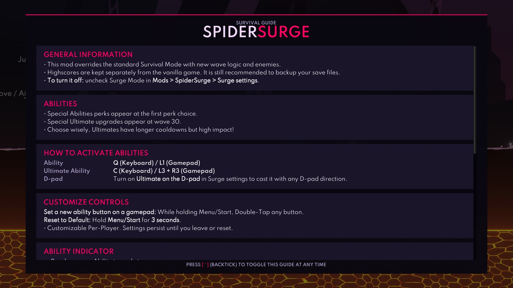

# Surge

The Surge part of [SpiderSurge](../README.md): a gameplay overhaul for Survival that introduces "Surge Mode", powerful new abilities, and fearsome custom enemies.

To play, stand on the **Surge Survival** platform above and to the left of **Wave Survival** in the lobby. Everyone joins the platform for the usual countdown, then chooses a pain level. The original Wave Survival platform still starts normal Survival. No settings toggle is needed.

## Features

- **Surge Mode**: A high-intensity survival mode overhaul that increases enemy spawn rates and introduces unique wave-based progression.
- **New Abilities**:
    - **Kinetic Pulse**: Release a kinetic pulse that destroys projectiles and repels enemies.
    - **Bottomless Clip**: Grants a brief period of unlimited ammunition for equipped weapons.
    - **Pocket Dimension**: Store and recall weapons at will, enabling advanced inventory tactics.
    - **Null Field**: Become immune to all damage for a short time.
    - **Freeze Time**: Freeze every enemy in a large area for 5 seconds. Casting it on enemies another player already froze doesn't add time, it only keeps the longer freeze. **Deep Freeze** (Ability Duration) freezes for longer and farther away. Its Ultimate, **Rewind**, turns every nearby enemy back into a plain Wasp; shielded enemies become shielded Wasps.
- **Custom Enemies**:
    - **Twin Whisp**: A black/red Whisp that fires dual projectiles simultaneously.
    - **Missile Whisp**: Uses the RocketTurret's body while flying and launching rockets. Cyan when unshielded and purple when shielded.
    - **Twin Blade Whisp**: Elite melee enemies equipped with dual-ended particle blades.
    - **Wasp Cocoon**: A stationary cocoon that hatches a Wasp every 10 seconds until it's destroyed, with at most 2 of its Wasps alive at once. Its Wasps don't count toward the wave's limit on live enemies, but the wave still ends only once they're dead. A shielded cocoon hatches Shielded Wasps while its shield holds.
    - **Laser enemies**: Red-shielded versions of most enemies (not the Exploding Roller or already shielded ones). Every 5 seconds a faint ring and the Death Ray's charge sound warn for 1 second, then a Laser Cannon ring around the enemy burns for 1 second. Breaking the red shield removes the ring for good.
- **Perk Synergy System**: Gain unique bonuses when combining specific mod abilities with vanilla perks (e.g., Bottomless Clip + Efficiency).
- **Ultimate Upgrades**: Your ability's Ultimate is guaranteed as a choice at wave 30 and can appear in regular perk choices afterwards until unlocked. At wave 60, you can unlock it or switch to another ability with its Ultimate.
- **In-Game Guide**: Explains the new mechanics, controls and perk synergies. It opens on the first launch, and the backtick key (**`**) opens it at any time.
- **Luck Perk**: A new perk that provides a chance to skip perk levels and jump straight to higher-tier upgrades.
- **Custom Controls**:
    - **Ability**: **Q** or **L1**. **Ultimate**: **C**, or **L3 + R3** together, or any D-pad direction if you turn that on.
    - **Per-Player Remapping**: While holding **Start/Menu**, **double-tap** any button to set it as your ability key.
    - **Reset**: Hold **Start/Menu** for 3 seconds to reset to default (L1).
- **Pause menu confirmations**: **Restart** and **Main Menu** in the pause menu ask "Are you sure?" before acting.
- **Team Versus**: With the [Teams](../teams/README.md) part on, everyone can get the same Surge ability in versus.

## How to configure Surge

### From the Mods menu:

Open the pause menu and pick **Mods** > **SpiderSurge** > **Surge**. Changes apply right away, except **Ultimate on the D-pad**, which applies from the next run. **Reset Surge settings to defaults** at the bottom keeps your telemetry choice.

### Using the Yaml file:

Surge's settings are the `surge` section of `...\Silk\Config\Mods\SpiderSurge.yaml`. See [Settings](../README.md#settings) for how the file works.

Explanation of the fields

### Gameplay:
The lobby platform selects the mode for each run. Older `surge.surgeMode` and `parts.surge` settings are ignored.

`surge.dpadUltimate`: If true, any D-pad direction casts the ultimate, instead of L3 and R3 together. While it's on, the D-pad doesn't switch the Stats windows. Default: `false`.

`surge.unlimitedPerkTime`: Disables the timer on the perk selection screen. Default: `true`.

### UI:
`surge.showTutorial`: Opens the Surge guide on the next launch, then turns itself off. Default: `true`.

`surge.indicator.radius`: The size of the ability indicator, from 0.5 to 10. Default: `1.5`.

`surge.indicator.offset.x`, `surge.indicator.offset.y`: Where the indicator sits, relative to the spider. Defaults: `3` and `8`.

`surge.indicator.availableColor`, `surge.indicator.cooldownColor`, `surge.indicator.activeColor`: The indicator's color when the ability is ready, on cooldown, and active, as hex codes. The Mods menu cycles through 8 colors; in the file you can use any hex code. Defaults: `#00FF00`, `#FF0000` and `#87CEEB`.

`surge.indicator.showOnlyWhenReady`: If true, the indicator only appears when the ability is off cooldown. Default: `false`.

### Logging:
`surge.statsLogging`: Records each run's ability and ultimate use to a local file, and feeds it to the Stats titles and the telemetry. Default: `true`.

`surge.telemetry`: Uploads anonymous stats for each finished Surge Survival run. See [Telemetry](#telemetry). Default: `false`.

`surge.showTelemetryPrompt`: Asks whether to share run stats a few seconds after the game starts. Answering the question turns it off. Default: `true`.

## Telemetry

SpiderSurge supports optional telemetry to help track balancing and gameplay trends in Surge matches.

### How to enable

Telemetry is off until you agree. The first time the game starts with Surge on, a popup asks whether to share anonymous run stats. You can change your answer at any time with **Share anonymous run stats** on the **Run stats and telemetry** page under Surge, or `surge.telemetry` in the file. Uploads also need **Track ability use in each run** (`surge.statsLogging`) on.

### Privacy and identity

- Telemetry uses an anonymous random ID, not player names.
- The anonymous ID is generated locally and stored in:
    `...\Silk\Logs\SpiderSurge\telemetry_anonymous_id.txt`
- The **Run stats and telemetry** page shows the ID, and **Reset telemetry ID** replaces it with a new one.

### Local log files (non-telemetry)

When `surge.statsLogging` is on, per-match text reports are written to:

`...\Silk\Logs\SpiderSurge\SpiderSurge_Match_YYYY-MM-DD_HH-mm-ss.txt`

## Stats Integration

When the [Stats](../stats/README.md) part is also on, Surge adds its ability and ultimate data to the stats log and registers custom player titles.

### Custom Stats

At the end of each Surge Survival match, the following per-player stats are appended to the Stats log file:
- **Ability Activations** — how many times each player activated their ability
- **Ultimate Activations** — how many times each player activated their ultimate

### Custom Titles

Surge registers the following titles through the Stats title system. Titles require **2+ players** and a **clear leader** (no ties):

| Title | Earned by |
|---|---|
| Enhanced | Most ability activations |
| Ultimate Form | Most ultimate activations |
| Powered Up | Most ultimate and most ability activations |
| Maximum Power | Most ultimate and fewest ability activations |
| Simple is Better | Most ability and fewest ultimate activations |
| Vanilla | Fewest ultimate and fewest ability activations |
| Ability Destroyer | Most ability activations and most offence |
| Wasn't Fast Enough | Most Null Field activations and most damage taken |
| Down with the Ship | Most Kinetic Pulse activations and most lava deaths |
| Boom Boom | Most Thermal Detonation activations and most explosion kills |
| Self Sacrifice | Most Neural Backup activations and most damage taken |

The last five combine Surge data with Stats requirements, creating **cross-part titles** that reflect both parts' tracked stats.

## Notes and disclaimers

- This mod overrides the highscores displayed in the survival menu. This is intentional, as it allows you to see your highscores for the modded game. The global position in the leaderboards will NOT be tracked, as this requires changes to the backend. Surge Survival keeps its own highscores, and Wave Survival still shows your normal ones. BACK UP YOUR SAVE FILES JUST IN CASE.
- Surge Mode is designed for Survival Mode. Its abilities only reach versus through the [Teams](../teams/README.md) part.

## The Future

- More abilities and ults
- More enemies
- Even harder mode?
