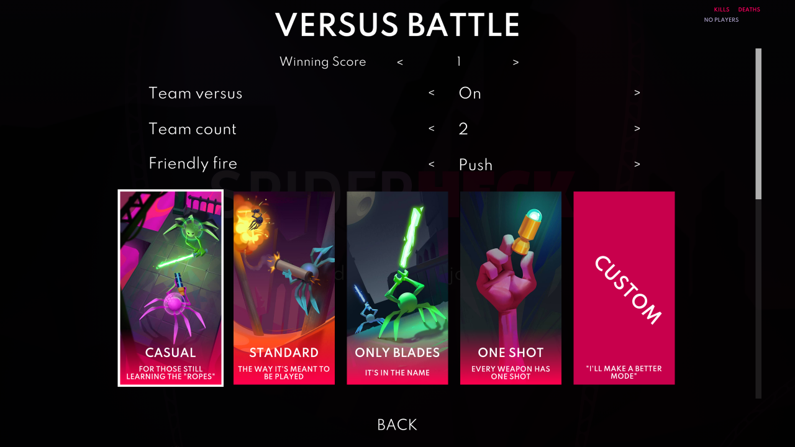
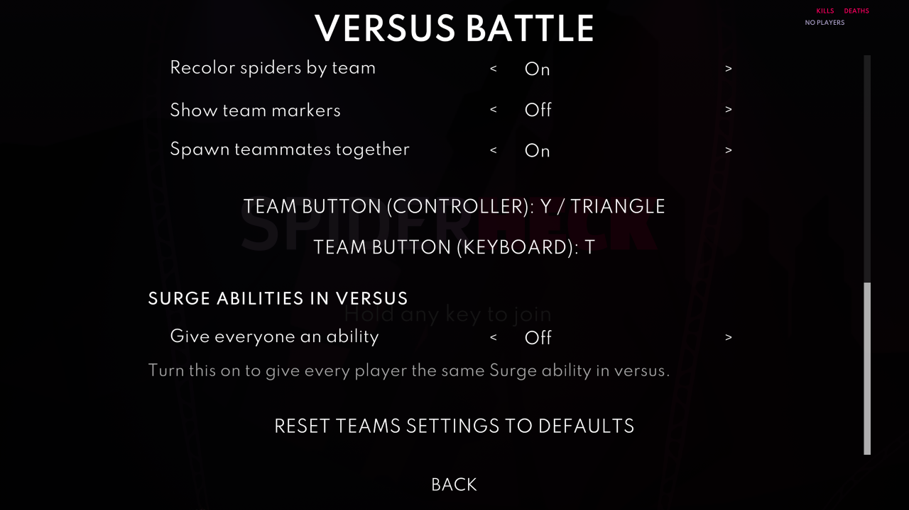

# Teams

The Teams part of [SpiderSurge](../README.md): team versus for SpiderHeck. Split the lobby into teams and fight it out: a round ends when only one team is left standing, not one spider.

## Features

- **Team Versus**: A versus round ends when one team is left standing. Every member of the winning team scores, alive or dead, and the first team to reach the winning score takes the match.
- **Any Number of Teams**: Play with 2 to 32 teams. With as many teams as players, everyone is on their own team, which plays exactly like normal free-for-all.
- **More Than 4 Players**: Works with [InfiniteFriends](https://github.com/Dylan-Grinboju/InfiniteFriends) for up to 32 players.
- **Pick Teams in the Lobby**: Press **Y / Triangle** on a controller or **T** on the keyboard to switch to the next team; change these buttons in **Mods** > **SpiderSurge** > **Controls**. New players join the smallest team automatically.
- **Configurable Friendly Fire**: Teammates' hits can push you (the default), do nothing, or work as normal.
- **Team Visuals**: Recolor spiders in their team's color, show a team marker above each spider, both, or neither.
- **Team Spawns**: Teammates spawn close to each other, and the teams spawn apart.
- **Team Win Screen**: The win screen and the lobby summary show each team's score and members.
- **Surge Abilities**: With the [Surge](../surge/README.md) part on, give every spider the same Surge ability in versus, with its ultimate and perks if you like.
- **In-Game Settings**: Every setting can be changed from the versus setup page, including moving players between teams.

## Turning it on

Teams is off after installing SpiderSurge. Open the pause menu, pick **Mods** > **SpiderSurge** > **Enable or disable parts**, check **Teams**, and restart the game.

Team versus is on as soon as the part runs. You can turn team versus off between matches from the versus setup page, without restarting.

## How to Play

1. Gather everyone in the lobby. While team versus is on, the versus platform reads **TEAM VERSUS**.
2. Each player presses **Y / Triangle** (controller) or **T** (keyboard) to switch to the next team. Every switch is announced, for example "P2 joined Blue Team".
3. Start versus as usual. Teams are locked until the match ends.

- A round ends when only one team has spiders alive. If the last spiders all die during the slow motion at the end of a round, the round is a draw.
- Every member of the winning team gets a point, alive or dead, so everyone on a team has the same score on the scoreboard.
- The first 8 teams are Red, Blue, Green, Yellow, Purple, Orange, Cyan and Pink. From the 9th team on, teams are numbered and get generated colors.
- Teams are kept between matches until someone changes them or leaves. They are not saved when you quit the game.
- Online players switch with the team button too. The host can also move anyone from the versus setup page.

## Friendly Fire

| Mode | What a teammate's hit does |
|---|---|
| `push` (default) | Knocks you back and stuns you, but never kills you or breaks your shield |
| `ignore` | No damage, knockback or stun from friendly attacks; Kinetic Pulse still pushes teammates |
| `damage` | Works as normal and can kill |

- Hitting yourself always works as normal, so your own grenade can still kill you.
- If the mod can't tell who caused a hit, the hit works as normal. A gap in the tracking will never save someone from a real kill.

## Surge Abilities

Versus can use the abilities of the [Surge](../surge/README.md) part. Turn on **Give everyone an ability** under **Surge abilities in versus** on the versus setup page; it is off by default. It works in normal free-for-all versus too, not only with teams.

- Everyone gets the same ability. Pick one, or **Random** for a new one every round, never the same one twice in a row. The ability is announced at the start of the match, and every round in Random mode.
- Use the ability with **Q** or **L1**, and the ultimate with **C** or **L3 + R3** together, the same as in Surge; **Mods** > **SpiderSurge** > **Controls** changes them. To move your own ability to another button, hold **Select** and double-tap that button.
- Each round starts fresh, so stored weapons don't carry over.
- Changes on the versus setup page apply from the next round.

| Ability | What it does | Ultimate |
|---|---|---|
| Null Field | Become immune to all damage for a short time | **Neural Backup**: After a cast time, revive a dead teammate at the map spawn point nearest you. With nobody to revive, it summons friendly wasps, which only chase AI enemies |
| Bottomless Clip | Shooting uses no ammo for a short time | **Care Package**: Spawns weapons at half of the map's weapon spawners, or all of them with Ability Duration level 2 |
| Kinetic Pulse | Release a pulse that knocks back everyone nearby | **Thermal Detonation**: The pulse kills anyone close to you. Teammates follow the friendly fire rule |
| Pocket Dimension | Store your weapon and swap it back later | **Black Hole**: For 3 seconds a pull around you drags spiders toward you, and any spider that reaches your inner circle goes into the pocket dimension, forever. Teammates are pulled unless friendly fire is set to ignore, and swallowed only with it set to damage |

The perks work like in Surge, and everyone gets the same ones:

- **Ultimate**: Everyone also gets the ability's ultimate.
- **Ability Cooldown**: Level 1 shortens the ability's cooldown, level 2 also the ultimate's.
- **Ability Duration**: Level 1 strengthens the ability, level 2 also the ultimate. With Kinetic Pulse it's called **Bigger Pulse**, and with Pocket Dimension **Faster Retrieval**.
- **Short Term Investment**: Buffs the ability's duration and cooldown, but nerfs the ultimate's.
- **Long Term Investment**: Buffs the ultimate's duration and cooldown, but nerfs the ability's.

## How to configure Teams

### From the versus settings page:

Open the normal **Versus Battle** setup page. Team versus, team count and friendly fire appear above the versus presets; scroll down for the other team options. The same controls are also available when customizing a versus preset. The page has every setting from the Yaml file, plus:

- The team list, which shows each player under their team. The host can move a player to another team with the arrows next to their name, shuffle everyone, or balance the team sizes.
- **Reset Teams settings to defaults**.

Changes apply right away and are saved to the Yaml file. The page only opens from the lobby, so the settings stay the same for the whole match. Only the host can open it. The Surge settings only show while the Surge part runs. Enable the Teams part under **Mods** > **SpiderSurge** > **Enable or disable parts** and restart the game if the controls are missing.

### Using the Yaml file:

Teams' settings are the `teams` section of `...\Silk\Config\Mods\SpiderSurge.yaml`. See [Settings](../README.md#settings) for how the file works. If a value is invalid, the mod uses the default instead (or the nearest allowed team count) and writes a warning to the Silk log.

Explanation of the fields

### Teams:
`teams.enabled`: Toggles team versus. If false, versus plays exactly like the base game. Default: `true`.

`teams.count`: How many teams to split the players into, from 2 to 32. New players join the smallest team, so with at least as many teams as players everyone starts on their own team. Default: `2`.

### Friendly fire:
`teams.friendlyFire`: What a teammate's hit does: `push`, `ignore` or `damage`. See [Friendly Fire](#friendly-fire). Default: `push`.

### Visuals:
`teams.recolorSpiders`: During a match, each spider's main color becomes a shade of its team's color. Teammates get slightly different shades, so you can still tell them apart. Second colors and hats are kept, and the original colors come back when the match ends. Your saved colors are never changed. Default: `true`.

`teams.showMarker`: Shows a team-colored marker above each spider, in the lobby and during matches. Each player turns it on for their own screen. Default: `false`.

You can use both, one, or neither. With both off, teams only show in the announcements and on the versus setup page.

### Spawns:
`teams.groupTeammates`: Spawns teammates close to each other, with the teams spread apart. Works with any number of spawn points, including the extra ones from InfiniteFriends. Default: `true`.

### Input:
The team buttons are `controls.teams.controller` (default `<Gamepad>/buttonNorth`, Y / Triangle) and `controls.teams.keyboard` (default `<Keyboard>/t`), which **Mods** > **SpiderSurge** > **Controls** sets. In the lobby, a team button that is also the game's show-names button (Y or Tab) only switches team. Older `teams.buttonGamepad` and `teams.buttonKeyboard` values move there on the first launch; Select / Back can't be a team button any more, so it goes back to Y.

### Surge:
These only matter while the Surge part runs. See [Surge Abilities](#surge-abilities).

`teams.surge.enabled`: Gives every spider the same Surge ability in versus. Default: `false`.

`teams.surge.ability`: The ability everyone gets: `immune` (Null Field), `ammo` (Bottomless Clip), `pulse` (Kinetic Pulse), `storage` (Pocket Dimension), or `random` for a new one every round. The ability's name works too, such as `Null Field`. Default: `pulse`.

`teams.surge.ultimate`: Also gives everyone the ability's ultimate. Default: `false`.

`teams.surge.abilityCooldown`: The Ability Cooldown perk level, from `0` (off) to `2`. Default: `0`.

`teams.surge.abilityDuration`: The Ability Duration perk level, from `0` (off) to `2`. Default: `0`.

`teams.surge.shortTermInvestment`: Gives everyone the Short Term Investment perk. Default: `false`.

`teams.surge.longTermInvestment`: Gives everyone the Long Term Investment perk. Default: `false`.

## Online Play

Teams runs on the host. Every player needs the same SpiderSurge version, since the host turns away anyone else. Couch games on one PC always count as hosting, so they just work.

- **You host**: The team rules, friendly fire and team spawns apply to everyone.
- **Someone else hosts**: Their team settings apply until you leave, and a one-time message says so when a match starts.
- Online players pick their team with the team button too; the host applies the pick.
- Like other gameplay mods, SpiderSurge makes Silk turn off leaderboard score uploads for the session.

## Compatibility

- **[InfiniteFriends](https://github.com/Dylan-Grinboju/InfiniteFriends)**: Supported. Nothing in Teams assumes 4 players, and team spawns use the extra spawn points it adds.
- **[Surge](../surge/README.md)**: Its abilities can be used in versus, see [Surge Abilities](#surge-abilities). Survival with Surge is unchanged.
- **[Stats](../stats/README.md)**: Opponent kills and shield breaks count toward normal offence stats; teammate kills and shield breaks count as friendly fire. Solo streaks use your living teammates. Titles stay hidden after versus matches.

## Notes and disclaimers

- This part only changes versus. Survival is untouched.
- With team versus off, versus plays exactly like the base game. With one player per team, the rules are the same as normal versus, with team colors and announcements on top.
- A player who joins in the middle of a match starts at 0 points, even if their team is ahead. The match is still decided by the team's points.
- Team colors use the game's temporary color sync, so your saved spider colors are never touched.
- Between matches, use **Reset Teams settings to defaults**, or delete the `teams` section from the file; it will be recreated with default values on the next launch.

## The Future

- Giving a player who joins in the middle of a match their team's score
